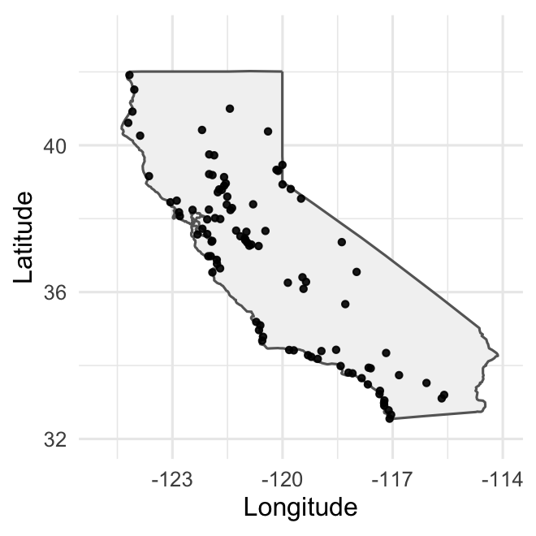
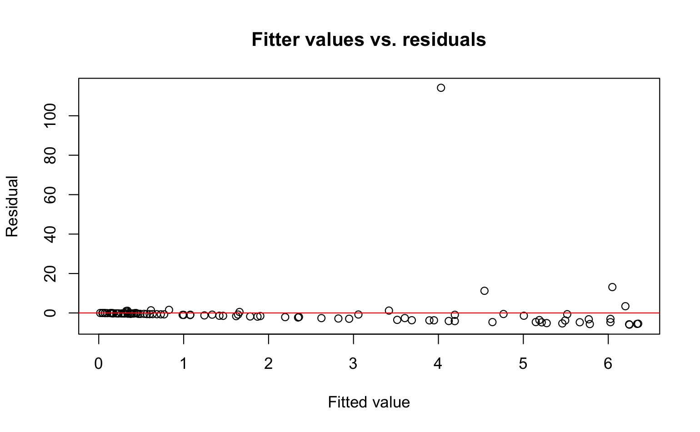
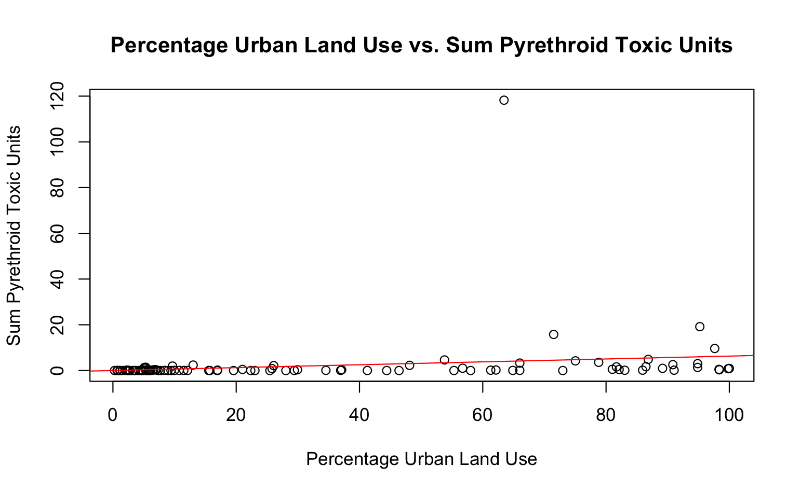

# Introduction

Urban land use can affect water quality because pollutants from developed areas may be transported into nearby waterways. In particular, pyrethroid pesticides are associated with toxicity in California watershed sediments, and previous SPoT monitoring found relationships between pyrethroid concentrations, toxicity, and urban land use [@phillips2020spot]. This study examines whether the percentage of urban land use surrounding a monitoring station is associated with the sum of pyrethroid toxic units measured at that station. Using observations from 100 California monitoring stations sampled in 2013, I fit a simple linear regression model with `PercentUrbanLandUse` as the explanatory variable and `SumPyrethroid_ToxicUnits` as the response variable. Because these data are observational, the analysis evaluates association rather than a causal effect.

# Data

## Dataset background

I will be using the Sum Pyrethroid Toxic Units dataset provided by the @waterboard2019pyrethroid. In this paper, the data will be referred to as the pyrethroid dataset for brevity. The pyrethroid dataset was complied for California's 2019 water quality status report by the [Stream Pollution Trends (SPoT) Monitoring Program](https://www.waterboards.ca.gov/water_issues/programs/swamp/spot/). The SPoT program was initiated to monitor and manage the contamination of streams statewide in California.

## Variables summary

The dataset contains 807 observations and these 6 relevant columns:

`StationCode`: monitoring watershed station identifier

`PercentUrbanLandUse`: percentage of the surrounding land classified as urban

`SumPyrethroid_ToxicUnits`: sum of pyrethroid pesticides expressed as toxic units

`Year`: sampling year

`SampleDate`: sampling date

`LandUse`: land-use category (Values can be "Urban", "Agriculture", "Open", "Ag/Urban")

Each row in this dataset represents a sample of sediment taken from the watershed station and tested for the potential for a pyrethroid pesticide to cause toxicity, which is the `SumPyrethroid_ToxicUnits` variable. Moreover, the dataset has samples from the 2008 to 2017. In order to eliminate this time dependence of samples in this dataset, I will only be using samples for the year 2013 to fit a linear regression model and answer the research question. This brings the dataset to subset of 100 rows with all 100 unique stations. I should also note the 2013 subset contains no missing values in either variable used in the regression.

The @fig-station-loc below shows locations of the watersheds in the dataset.

{#fig-station-loc width="300"}

## Key Variables

The key variables that are used to answer the research question are `PercentUrbanLandUse` and `SumPyrethroid_ToxicUnits`

### Percent Urban Land Use

`PercentUrbanLandUse` represents the percentage of land classified as urban within the 5-km drainage area surrounding each SPoT monitoring station. Researchers mapped these drainage areas using elevation data and extracted land-cover information from the National Land Cover Database (NLCD). Urban land cover included developed open space and low, medium, and high-intensity developed areas (NLCD categories 21--24) [@phillips2020spot].

### Sum Pyrethroid Toxic Units

`SumPyrethroid_ToxicUnits` represents the potential for a pyrethroid pesticide to cause toxicity, according to @phillips2020spot. In order to record these values at the various waterways in California, SPoT surveys are conducted every year between late spring to fall, where sediment is collected from recent stream bed deposits after a high flow season and tested for contaminants like pyrethroid pesticides. The SPoT 10 year report states that the contamination results should not be interpreted "as a characterization of the entire stream in which study sites were located" [@phillips2020spot]. The report rather suggests that the readings should be understood as relative indicators of annual pollutant mobilization and transport within the watersheds. In the dataset, 40 values out of 100 for `SumPyrethroid_ToxicUnits` are 0. This most likely due to the fact these pyrethroid readings correspond to watersheds location at areas that are classified as Open or Agricultural for the their `LandUse`.

# Method

To find whether there is an association between the `PercentUrbanLandUse` and `SumPyrethroid_ToxicUnits` in California waterways, I fit a simple linear regression model where the predictor variable is `PercentUrbanLandUse`, denoted as $X_i$, and the response variable is the `SumPyrethroid_ToxicUnits`, denoted as $Y_i$.

The simple linear regression model can be written as follows for all observations $i = 1 \text{ to } n$: $$
Y_i = \beta_0+ \beta_1X_i + \varepsilon_i
$$

$\beta_0$ is the intercept of the regression line. In the context of this paper, it represents the mean value of `SumPyrethroid_ToxicUnits` when `PercentUrbanLandUse` is 0.

$\beta_1$ is the slope of the regression line. $\beta_1$ represents the expected increase in Sum Pyrethroid toxicity for each unit increase in the percentage of urban land use.

The sampling distribution of $\frac{b_1 - \beta_1}{\hat{se(b_1)}}$ is $t(n -2)$. I will use this fact to test whether there is an association between the percent of urban land use and Pyrethroid toxicity in California waterways using a hypothesis test with confidence intervals. However, in order to draw any conclusions from the hypothesis test we must first check if the assumptions for this method are met.

## Linear model assumptions

The simple linear regression model assumes the following conditions:

1.  The predictors and response variables accurately represent the quantities of interest and answer the research question

2.  The dataset is representative of the population of interest

3.  Additivity and linearity

4.  All errors $\varepsilon_i$ are independent and normally distributed with mean 0 and finite variance

## Testing the assumptions

1.  The predictor variable used in this model is the percentage of urban land use and the response variable is th Sum Pyrethroid toxicity units. Based on the dataset, the variables accurate represent the quantities such that the research question can be answered.

2.  The stations are distributed across California as shown in @fig-station-loc, but they were selected through a targeted monitoring design rather than random sampling. Therefore, the results should be generalized primarily to SPoT-monitored watersheds and interpreted cautiously when discussing California waterways more broadly.

3.  

4.  The residual plot below shows that there is unequal variance in the errors. Moreover, there is a very noticeable outlier in the data as well which can be seen in the figure below.

<!-- {fig-align="center" width="450"} -->

## Hypothesis Test

The null and alternative hypothesis are:

$$
H_0: \beta_1 = 0
$$

$$
H_A: \beta_1 \neq 0
$$

# Results

I used the $\verb|lm()|$ function in R to fit a simple regression model @r_core_team. The estimated slope parameter $b_1$ is 0.0635150. This means that the variable `SumPyrethroid_ToxicUnits` is expected to increase by 0.0635150 for each unit in increase of `PercentUrbanLandUse`. The estimated intercept parameter $b_0$ is 0.0008118. This means that when `PercentUrbanLandUse` is 0, the average `SumPyrethroid_ToxicUnits` is 0.0008118.

{fig-align="center" width="450"}

# References
